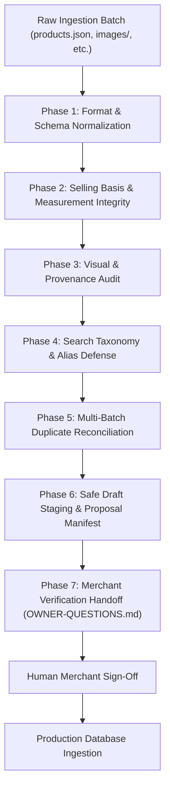

# bulk-product-verification: Bulk Catalog Verification & Safe Database Staging

Catalog ingestion is one of the highest-risk failure points in conversational commerce and e-commerce platforms. Raw catalog data from suppliers, web scrapers, or legacy spreadsheets invariably contains invalid selling units, conflated pack contents, AI-generated illustration artifacts, polluted category aliases, and duplicate variants.

This skill provides an end-to-end protocol and automated tooling to verify, clean, reconcile, and stage bulk product batches into a draft intake queue without risking production data corruption.

---

## The 7 Immutable Laws of Catalog Verification

1. **Never Conflate Pack Contents with Ordered Unit**:
   Inside one sellable unit (`unit: "can"`, `quantityStep: 1`) is the pack specification (`sellingPolicy.packContents: { value: 4, unit: "litre" }`). Quantity 2 means 2 cans, never 2 litres.
2. **Never Infer Merchant Sales Policy from Manufacturer Packaging**:
   Just because a factory coils rope in 100-meter bundles or extrudes pipe in 3-meter sticks does *not* mean the local shopkeeper cuts it by the meter. Default `cutAllowed: false` unless explicitly confirmed by the merchant.
3. **Never Convert Litres to Kilograms (or Mass to Volume)**:
   Chemical densities vary wildly (e.g. epoxy resin, paint, thinners, putty). Converting volume to weight destroys physical accuracy.
4. **Valid Hash & Decodable JPEG ≠ Verified Product Identity**:
   A clean JPEG under 2 MB with a valid SHA-256 hash can still display the wrong tool category (e.g. chisels for a hand saw) or an incompatible size (e.g. "180 mm" printed on a 20 mm fitting). Visual inspection of printed markings is mandatory.
5. **No AI-Generated Lettering on Technical Products**:
   Generative AI models hallucinate pseudo-alphanumerics on MCBs, meters, drill ratings, and gauges. Any image with garbled or invented technical markings must be excluded or flagged `unconfirmed`.
6. **Protect Search Routing: Category Aliases Must Remain Generic**:
   Placing brand names (e.g. "Bosch", "Berger") or model codes in category aliases restricts search routing to that specific category, hiding matching products across other categories. Brands belong exclusively in product-level keywords and fields.
7. **Zero-Trust Commercial Defaults for Draft Intake**:
   Unknown price is NOT zero price; unknown stock is NOT zero stock. Draft records must strictly default to:
   `pricePaise: 0`, `priceStatus: "confirm"`, `stock: null`, `active: false`, `verified: false`.
   Scraped or internet reference prices belong strictly in `research.json` as anchors.

---

## Pipeline Workflow



---

## Phase 1: Format & Schema Normalization

Every catalog batch must conform to a standardized package structure:
```
<batch_folder>/
├── products.json       # Product records conforming strictly to the draft schema
├── catalog-map.json    # Category taxonomy, generic aliases, and family hierarchies
├── research.json       # Manufacturer citations, source URLs, access dates, internet prices
├── exceptions.json     # Unresolved merchant policy questions and edge cases
└── images/             # Referenced product photos and illustrations
```

### Schema Rules
- **Specification Keys**: Must strictly use lowercase `snake_case` (e.g., `pipe_class`, `joint_type`, `pack_size`, `nominal_diameter`). Never use `camelCase`.
- **Localization Keys**:
  - `localNames.ta`: Tamil in Tamil script (e.g., `"யூபிவிசி பைப்"`).
  - `localNames["ta-Latn"]`: Tanglish / transliterated Tamil (e.g., `"UPVC Pipe"`).
- **Stable Identifiers**: Retain original vendor/batch SKUs. Never rename SKUs solely to satisfy path regexes.
- **Forbidden Draft Fields**: Do not include internal runtime flags (e.g. `sellingUnitVerified`) on draft product records.

---

## Phase 2: Selling Basis & Physical Integrity

Verify the physical mechanics of sale for every item:

| Sale Mode | Example Item | `unit` | `quantityStep` | `saleMode` | `packContents` | `cutAllowed` |
| :--- | :--- | :--- | :--- | :--- | :--- | :--- |
| **Pack / Container** | 4L Asian Paints Apex Can | `"can"` / `"bucket"` | `1` | `"pack"` | `{ value: 4, unit: "litre" }` | `false` |
| **Loose by Weight** | 2-inch Wire Nails | `"kg"` | `0.5` or `1` | `"measured"` | `null` | `false` |
| **Pre-packed Box** | 1kg Box of Screws | `"box"` / `"pack"` | `1` | `"pack"` | `{ value: 1, unit: "kg" }` | `false` |
| **Rigid Length** | 3m PVC Pipe (Full length) | `"length"` / `"piece"` | `1` | `"piece"` | `{ value: 3, unit: "metre" }` | `false` |
| **Continuous Cut** | Garden Hose / Wire by Metre | `"metre"` | `1` | `"measured"` | `null` | `true` |

### Critical Verifications:
1. **Quantity Ambiguity**: If a customer orders "2 cans", the quantity must represent cans. If they order "10 meters", the unit must be `metre`.
2. **Cutting Policy**: Default `cutAllowed: false` for all hose rolls, pipes, cables, and chains unless the merchant explicitly confirms in-store cutting.
3. **Compound Packs**: For multi-component packs (e.g. Araldite epoxy: 100g resin + 80g hardener), set `pack_size: "180 g"` and document composition explicitly in `specifications.composition`.

---

## Phase 3: Visual & Provenance Audit

Automated image decoding is insufficient. You must audit image-to-product mapping across four distinct vectors:

### 1. Category-Level Match
- Verify that the image depicts the exact category.
- *Historical failure mode*: Hand saw pointing to woodworking chisels; diagonal pliers pointing to a bench vice.

### 2. Printed Markings & Nominal Size Match
- Inspect visible stamped, molded, or printed text on the product or box.
- *Historical failure mode*: A 20 mm UPVC elbow accompanied by a product photo prominently embossed with `"180 mm"`.
- *Action*: If the image contradicts the record, flag it in `demo-exclusions.json` with `excludeImage: true`. Never alter product specifications to match a contradictory photo.

### 3. AI Artifacts and Hallucinated Lettering
- Inspect AI-generated illustrations for illegible scribbles, garbled technical ratings, or distorted proportions on MCBs, power tools, and gauges.
- *Action*: Exclude unconfirmed AI artwork with garbled text. Label all generated media as `generated: true`, `identityPreserved: false`.

### 4. Image Enhancement Transparency
- Upscaling, sharpening, or converting to JPEG Quality 95 is **lossy**, not lossless.
- Always maintain original source image checksums alongside transformed file checksums in `image-edits.json`.

---

## Phase 4: Search Taxonomy & Alias Defense

Search engines and conversational agents rely on `catalog-map.json` for category intent classification.

- **Category Aliases**: Must ONLY contain generic synonyms and category expressions.
  - ✅ Correct: `"exterior paint"`, `"wall primer"`, `"weatherproof emulsion"`, `"water pump"`
  - ❌ Corrupt: `"asian paints apex"`, `"dulux weathershield"`, `"crompton 1hp pump"`
- **Why?** Injecting brand names or specific models into category aliases hijacks search routing. A search for "Asian Paints Tractor Emulsion" might get pinned to "Exterior Paints", hiding interior emulsions from the user.
- **Where Brand Belongs**: Brands belong strictly in the product record (`brand: "Asian Paints"`), product `aliases`, and `keywords`.

---

## Phase 5: Multi-Batch Duplicate & Variant Reconciliation

When processing multiple catalog batches or incremental updates:

1. **Non-Destructive Reconciliation**:
   - Never delete records from source batches. Fixed-size batch validation and legacy import manifests will break.
   - Maintain a master `canonical-sku-map.json` linking source SKUs to canonical cluster IDs.
2. **Variant vs. Duplicate Distinction**:
   - Do NOT merge distinct physical variants. Compare:
     - Model number / formulation (e.g., Berger WeatherCoat Anti Dust vs Smooth Exterior).
     - Nominal size / weight (e.g., 90g vs 100g tube; 1kg vs 20kg bag).
     - Mechanical specs (e.g., 3-lever vs 7-lever brass padlock).
3. **Canonical Mapping States**:
   - `unique`: Product has no duplicates across batches.
   - `confirmed_duplicate`: Exact identical brand, model, size, color, and pack contents.
   - `needs_review`: Apparent overlap where pack contents or specifications conflict.

---

## Phase 6: Safe Draft Staging & Proposal Manifest

Never write directly to production database tables (`products`, `inventory`, `prices`). Always stage catalog batches as **Draft Proposals**.

### Draft Proposal Manifest
Use the MCP proposal schema:
```json
{
  "proposalId": "prop-batch-001-sku-123",
  "batchId": "batch-2026-10-hardware",
  "sourceSku": "KSMC-001",
  "product": {
    "sku": "KSMC-001",
    "name": "Asian Paints Apex Ultima White 4L",
    "brand": "Asian Paints",
    "pricePaise": 0,
    "priceStatus": "confirm",
    "stock": null,
    "active": false,
    "verified": false,
    "unit": "can",
    "quantityStep": 1,
    "sellingPolicy": {
      "saleMode": "pack",
      "packContents": { "value": 4, "unit": "litre" },
      "cutAllowed": false
    }
  },
  "asset": {
    "assetId": "asset-ksmc-001",
    "filePath": "images/KSMC-001.jpg",
    "sha256": "...",
    "sourceType": "manufacturer_photo",
    "identityPreserved": true,
    "displayApproved": true
  }
}
```

---

## Phase 7: Merchant Verification Handoff

Do not guess merchant operational realities. Automatically compile an `OWNER-QUESTIONS.md` document structured into actionable sections:

1. **Demo Shortlist Pricing**: Top 5–10 representative items requiring immediate retail prices for live demonstrations.
2. **Cutting & Custom Measurement Policies**: Explicit questions asking if the shop sells pipes, wire, rope, or hoses by the metre.
3. **Loose vs Pre-Packaged Hardware**: Asking whether nails, screws, and washers are sold loose by weight or in pre-counted blister packs.
4. **Variant Distinctions**: Asking the merchant to confirm distinct physical shelf items identified during deduplication.

---

## Tooling & Verification Scripts

This skill includes automated validation tools in the `scripts/` directory:

- `python3 scripts/validate_catalog.py <batch_path>`:
  Runs complete syntax, schema, selling basis, image decodability, and commercial default verification on any catalog folder.
- `python3 scripts/reconcile_duplicates.py <folder1> <folder2> ...`:
  Analyzes cross-batch records and generates a `canonical-sku-map.json` without modifying source files.
